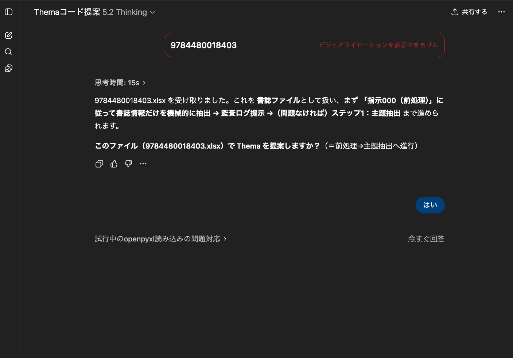
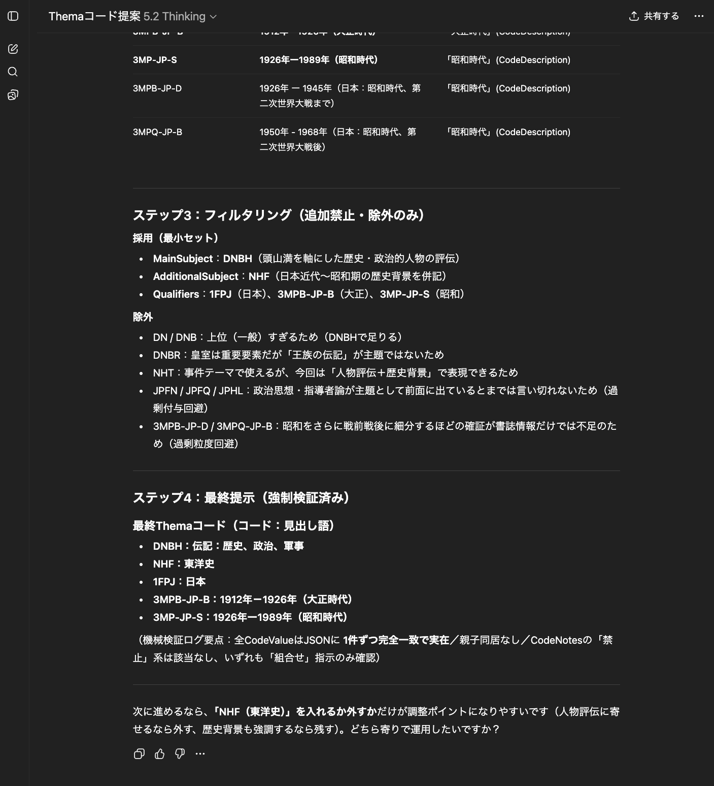

# thema-oracle / Themaコード提案
書誌情報からThemaコードを推論し、提案するカスタムGPT (a.k.a. Themaコード提案)

**Thema Oracle / Themaコード提案** は、国際的書籍主題分類である **Thema** を前提として、  
日本語書誌情報（内容紹介・目次・キーワード等）から  
**Themaコードの候補を提案するための意思決定支援ツール**です。

本リポジトリは、  
👉 **カスタムGPT「Themaコード提案」への入口**  
👉 **利用方法・設計思想・位置づけ・運用方針を示すドキュメント置き場**  
として機能します。

---

## 🔗 利用方法

### カスタムGPT（本体）

- **[Themaコード提案（カスタムGPT）](https://chatgpt.com/g/g-693067d2ba6481919c803275a2b0b24d-themakototi-an)**  
  

書誌情報（ISBN、内容紹介、目次、キーワード等）を入力すると、  
Thema に基づいた **Thema主題（+クォリファイア）コード候補** を返します。

⓪JPROの登録システムで、ISBNで検索するなどして、書誌を一点だけ表示し、「Excel出力(紙)」をクリックし、手元に書誌情報をダウンロードします

①ダウンロードしたファイルを開き、2行目を削除して保存します（このステップは省略しても問題ありませんが、JPROシステムが生成するエクセルファイルは機械処理が難しく、GPT内部で回避処理を行うという余計なステップが発生するので、この方が処理が速くなります）

②「Themaコード提案」を開き、先ほどのエクセルファイルをチャットウインドウにドラッグ＆ドロップします。「Enter↩️」で処理が始まります。（「Themaを提案して」がスタートの合言葉なので、このフレーズを添える方がスムースに進むことがあります）

③処理が始まります。そのまま最終ステップまで一気に進むこともありますが、指示を仰いでくることがあるので、「はい」「ok」などと入力すると進みます

④このように処理が止まったら「ok」などで進めます

⑤「ステップ4」で表示されるものが「最終回答」なので、問題なさそうならばこれを採用して終わり、です。例のように、さらなる提案の道筋を示すこともあるので、自然文で指示をすれば、追加のコードなども提案してくれます。また、「最終コードをONIX形式で表示して」などと指示すると、ONIXのXMLを出力してくれます。コードの提案過程で付番に疑問が生じた場合は、理由を訊くと**EDItEURの配布文書に基づいた提案根拠**を回答してくれるので、Thema自体のナレッジナビゲーターとしても使えます

> ⚠️ 本ツールは **最終的な主題決定を代替するものではありません**。  
> 出版社・編集者等、書誌情報発信者による判断を支援するための参考提案です。

---

## 🎯 想定利用者

- 出版社（編集・制作・営業・デジタル部門）
- 出版流通・取次
- 図書館・研究機関
- ONIX / Thema に関心を持つ実務者・研究者
- 業界団体における検討・評価用途

---

## ❓ なぜ Thema なのか

**Thema** は EDItEUR により策定された、  
国際的に利用可能な書籍主題分類スキームです。

- 国境・言語を超えた主題記述
- EC・検索・推薦との親和性
- ONIX との高い整合性

といった特徴を持ち、  
日本の出版流通においても共通主題分類スキームの基盤となることが期待されています。

本プロジェクトは、  
**単にThema を付けるのではなく、抽象化された主題の提示と、高精度なThemaコード付番の提案による、実運用に耐えうる高品質な主題分類の推進**に焦点を当てています。

---

## 🧠 このツールが重視している観点

「Themaコード提案」 は、単純な自動分類ではなく、  
以下のような **運用上の判断点**を重視しています。

- 上位-下位コードの重複を避けた付番
- Qualifier（言語・形式・人物等）の、ルールに基づく適正利用
- 写真集など、日本市場特有の慣行
- 「分類として正しいが、実務上は不適切」なケースの回避

これらは、  
EDItEUR の *Using Thema documentation* に基づきつつ、  
日本語書誌データを前提に調整されています。

また、現状の生成AIの限界として「どこまでを推論し、どこまでを限定知識の厳密な参照とするか」という線引きの指示が難しく、単純にChatGPTに尋ねるだけでは「口から出まかせ」のThemaコードを回答してしまう（いわゆるハルシネーション）ので、本ツールではこの「線引き」の設計を徹底しています。

---

## ⚠️ 正式性・立場について

- 本プロジェクトは、EDItEUR、JPO 等の公式見解を代替するものではありません
- Themaコードの最終決定責任は、常に出版社（書誌情報の発信者）にあります

---

## 🤝 コラボレーションについて

以下のような協力・フィードバックを歓迎します。本ツールの運用ルールに反映することで、利便性の改善および、Themaコード付番のさらなる精度向上が期待できます。

- 付番が難しいケースの共有
- 運用上の判断基準に関する議論
- 出版社・業界団体での試行利用
- 教師データ／評価観点の検討

---

## 📄 ライセンス

本リポジトリは、以下のライセンスのもとで公開されています。

**Creative Commons Attribution-ShareAlike 4.0 International  
(CC BY-SA 4.0)**

- クレジット表示（BY）を条件に利用・改変・商用利用が可能
- 改変物を配布する場合は、同一ライセンスでの公開が必要

👉 詳細:  
https://creativecommons.org/licenses/by-sa/4.0/